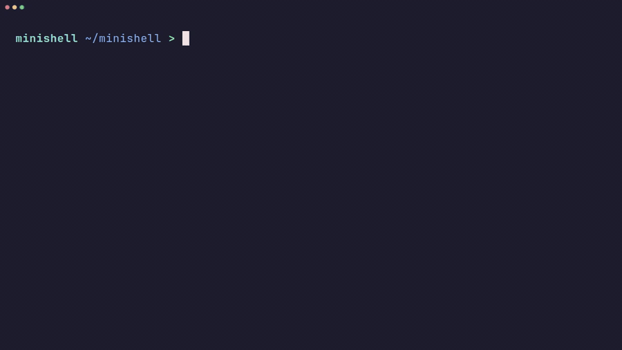

# minishell

A small Bash-like shell written in C, as part of the 42 school curriculum.



## Features

- Prompt with command history (GNU readline)
- Executable lookup via `PATH`, or relative/absolute paths
- Single `'` and double `"` quotes
- Redirections: `<`, `>`, `>>` and heredoc `<<`
- Pipes `|`
- Environment variables (`$VAR`) and exit status (`$?`)
- `Ctrl-C`, `Ctrl-D` and `Ctrl-\` behave like in Bash
- Builtins: `echo -n`, `cd`, `pwd`, `export`, `unset`, `env`, `exit`

## Usage

Requires `cc`, `make` and the readline library (`libreadline-dev` on Debian/Ubuntu).

```sh
make
./minishell
```
